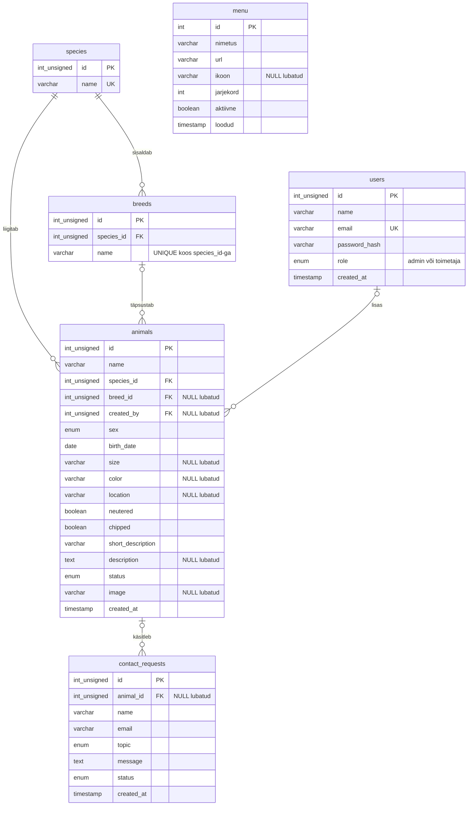

# Lõppversiooni ER-diagramm

Diagramm kirjeldab `www/veebirakendus/sql/schema.sql` faili ja andmebaasi `mario_kapakodu`. Olemasolevale paigaldusele lisab uued seosed `sql/migrations/20261119_course_completion.sql`. Mermaid-diagramm kuvatakse GitHubis.

## Seosed ja kustutamine

| Viitav väli | Viidatav väli | ON DELETE | ON UPDATE |
| --- | --- | --- | --- |
| `breeds.species_id` | `species.id` | CASCADE | RESTRICT |
| `animals.species_id` | `species.id` | RESTRICT | RESTRICT |
| `animals.breed_id` | `breeds.id` | SET NULL | RESTRICT |
| `animals.created_by` | `users.id` | SET NULL | CASCADE |
| `contact_requests.animal_id` | `animals.id` | SET NULL | CASCADE |

Kui SQL-is puudub `ON UPDATE` reegel, kasutab MySQL vaikimisi `NO ACTION` käitumist, mis InnoDB korral vastab `RESTRICT`-ile. Liiki ei saa kustutada, kui sellele viitab loom. Looma tõu kustutamisel jääb loom alles ning tõuviide muutub `NULL`-iks. Kasutaja kustutamisel jääb loom alles; looma kustutamisel jääb kontaktipäring alles.

Üks liik võib sisaldada mitut tõugu ja looma; iga loom kuulub ühele liigile. Tõug, lisaja ja kontaktipäringu loomaseos võivad puududa. `menu` on eraldiseisev tabel ega vaja kunstlikku seost teiste tabelitega. Vanade loomade lisaja on migratsiooni järel teadmata (`NULL`); uue looma lisamisel määrab rakendus lisajaks sisseloginud kasutaja. Päring võib olla üldine või puudutada ühte looma.

## Vastavus kursuse varasema etapiga

| Varasema `kapakodu` skeemi tabel | Lõppversiooni tabel |
| --- | --- |
| `liigid` | `species` |
| `toud` | `breeds` |
| `tootajad` | `users` |
| `loomad` | `animals` |
| `paringud` | `contact_requests` |
| `menu` | `menu` |

`database/kapakodu.sql` ja `database/designer.png` säilitavad ülesannete 2–6 ajaloolise lahenduse. Need ei kirjelda käesolevat lõppskeemi. Näiteks loomade vanus arvutatakse lõppversioonis `birth_date` järgi, mitte ei säilitata eraldi vanuseveerus.
