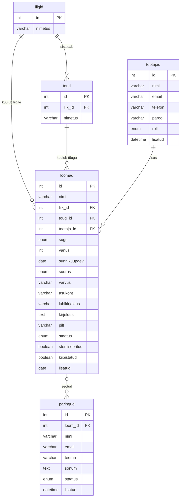

# Ülesanne 5 – ER-diagramm

Diagramm on koostatud Mermaid-süntaksis, mis kuvatakse GitHubis automaatselt. Tabelid vastavad Ülesanne 6 struktuurile.

## Kardinaalsused

- Üks liik sisaldab mitut tõugu (`liigid` 1 : N `toud`), iga tõug kuulub ühele liigile.
- Üks liik sisaldab mitut looma, iga loom kuulub ühele liigile (`liigid` 1 : N `loomad`).
- Üks tõug sisaldab mitut looma, iga loom kuulub ühele tõule (`toud` 1 : N `loomad`).
- Üks töötaja lisab mitu looma, iga loom on lisatud ühe töötaja poolt (`tootajad` 1 : N `loomad`).
- Looma kohta võib olla mitu päringut, päring võib olla seotud ühe loomaga või mitte (`loomad` 1 : N `paringud`, `paringud.loom_id` on NULL-lubatav).

## Võõrvõtmed

| Tabel | Väli | Viitab | Reegel |
| --- | --- | --- | --- |
| toud | liik_id | liigid.id | ON DELETE RESTRICT, ON UPDATE CASCADE |
| loomad | liik_id | liigid.id | ON DELETE RESTRICT, ON UPDATE CASCADE |
| loomad | toug_id | toud.id | ON DELETE RESTRICT, ON UPDATE CASCADE |
| loomad | tootaja_id | tootajad.id | ON DELETE RESTRICT, ON UPDATE CASCADE |
| paringud | loom_id | loomad.id | ON DELETE RESTRICT, ON UPDATE CASCADE |
